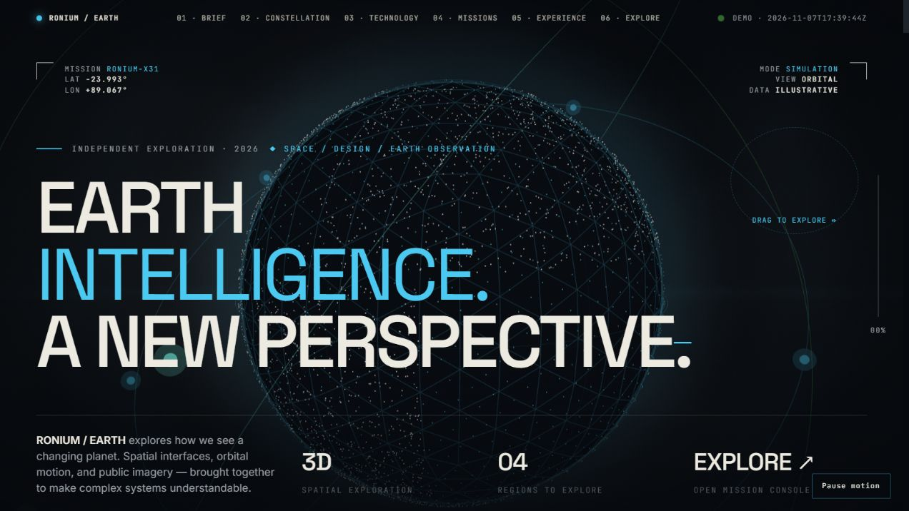

# RONIUM / EARTH — Interactive Earth Observation & Mission Explorer

**Designed and developed by Sandeep Pariyar.**

**[Explore the live demo →](https://sandeepariyar.github.io/ronium-earth-observation/)** · [Open the mission console](https://sandeepariyar.github.io/ronium-earth-observation/console/index.html#explorer) · No sign-in required

[](https://sandeepariyar.github.io/ronium-earth-observation/)

A design engineering project that brings Earth observation into an interactive spatial experience. Explore an animated globe, inspect an illustrative constellation, and use a working mission console to view public NASA imagery across four regions.

## A quick tour

1. Drag the globe using the circular control, or focus it and use the arrow keys.
2. Scroll through the constellation, imagery effects, and motion-led field study.
3. Open the mission console, choose a region and imagery layer, and prepare a simulated request.
4. Use **Back to RONIUM** to return. Motion can be paused at any time.

**Skills demonstrated:** visual design in Figma, frontend development, spatial interaction, WebGL graphics, scroll choreography, accessible motion controls, and public imagery integration.

## Design origin

The initial design was developed in **Figma**, exploring editorial hierarchy, spatial interfaces, and the visual language of Earth observation. The concept draws inspiration from **ICEYE** and its approach to satellite intelligence, then develops an independent RONIUM identity through interactive graphics, motion, and mission-oriented interface design.

This is an independent portfolio project, not an official ICEYE product or commissioned client project. RONIUM is not affiliated with or endorsed by ICEYE or NASA.

## Experience

- **Interactive globe:** pointer dragging and keyboard rotation, with ambient orbital motion.
- **Constellation study:** illustrative orbital paths and hoverable nodes.
- **Motion design:** scroll-driven depth, staged typography, image reveals, and a contextual flood-story sequence.
- **Visual effects:** transparent WebGL image overlays and a controllable looping scan animation.
- **Mission explorer:** four regions, two public NASA imagery layers, observation-date selection, and grid controls.
- **Local simulation:** prepare a demonstration request without submitting a satellite order.
- **Motion controls:** page-wide pause and reduced-motion support.

## Technology

React · Vite · Three.js · WebGL / GLSL · Canvas · JavaScript · CSS

The editorial experience uses lightweight JavaScript modules and Three.js. The mission console is a React application built as a second Vite entry point. Both pages deploy together as a static website.

## Run locally

Use Node.js 22.12 or later.

```sh
npm ci
npm run dev
```

For a production build:

```sh
npm run build
npm run preview
```

## Project structure

```text
index.html                 Editorial Earth observation experience
hero-globe.js              Interactive Three.js globe
constellation.js           Canvas constellation study
motion.js / motion.css     Scroll choreography and motion controls
image-shaders.js           Transparent image effects
console/index.html         Mission console entry point
src/console/               React controls and NASA imagery integration
public/assets/             Editorial artwork and scan animation
.github/workflows/         GitHub Pages deployment
```

## Data and visual context

NASA GIBS supplies the Blue Marble basemap and MODIS Terra optical imagery. These are not commercial SAR observations. Availability depends on the external service and selected date.

Orbital positions, changing coordinates, and mission requests are illustrative simulations. Editorial images are conceptual artwork, not satellite measurements, verified flood extents, or evidence of real events. Shader overlays are decorative.

References: [NASA GIBS](https://nasa-gibs.github.io/gibs-api-docs/) · [ICEYE — design inspiration](https://www.iceye.com/)

## Deployment

The Pages workflow builds both entry points and publishes `dist/` when `main` changes. In the repository's **Settings → Pages**, select **GitHub Actions** as the source. Relative asset paths support deployment under a repository subdirectory.

## Author

**Sandeep Pariyar** — design, interaction, and development.

[GitHub profile](https://github.com/sandeepariyar)

## License

MIT © 2026 Sandeep Pariyar. Dependencies retain their respective licenses. External data providers retain their own terms and attribution requirements.
